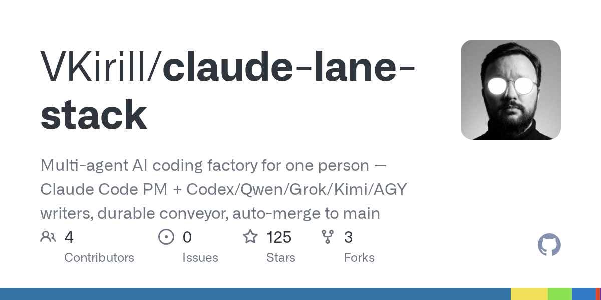

# Claude Code mod 精选

[English](https://github.com/claude-code-mods/best-claude-code-mods) · [简体中文](https://github.com/claude-code-mods/claude-code-mods-zh) · [繁體中文](https://github.com/claude-code-mods/claude-code-mods-zh-tw) · **日本語** · [한국어](https://github.com/claude-code-mods/claude-code-mods-ko) · [Español](https://github.com/claude-code-mods/claude-code-mods-es) · [Français](https://github.com/claude-code-mods/claude-code-mods-fr) · [Deutsch](https://github.com/claude-code-mods/claude-code-mods-de) · [Português (Brasil)](https://github.com/claude-code-mods/claude-code-mods-pt-br) · [Русский](https://github.com/claude-code-mods/claude-code-mods-ru)

**厳選、検証済み、バージョン固定。一度追加すれば 40 個の mod がすぐ使える。**

> **すべての 40 個の mod は日本語に完全ローカライズされています。** すべてのラベル、コマンド、パネル、プロンプト、README が翻訳済みです。プラグインのソースはこのリポジトリに同梱されているため、追加設定なしでインストール直後から UI は日本語で表示されます。コード識別子、hook イベント名、skills、モデル向けの指示のみ、動作を変えないために英語のままとしています。

Mod は関数フックで作られた Claude Code のプラグインです。Claude Code の動作を観察・変更・代行でき、独自の UI も描けます。このマーケットプレイスはコミュニティの優れた mod を集めたものです。どれも `claude plugin validate` で検証し、検証したコミットに固定しているので、作者のその後の変更がレビューなしで届くことはありません。

Claude Code 2.1.287 以降が必要です。

## インストール

Claude Code のターミナルセッションで：

```
/plugin marketplace add claude-code-mods/claude-code-mods-ja
/plugin install <mod 名>@claude-code-mods-ja
```

例：`/plugin install terminal-browser@claude-code-mods-ja`。新しい mod や更新を取り込むには `/plugin marketplace update claude-code-mods-ja` を実行します。

## カタログ

各カードの**アクセス**は、UI の描画以外に mod のコードができることとして検証ツールが報告した内容です。インストール前にソースを確認してください。検証はコードを実行せずに読むだけで、セキュリティ監査ではありません。

### ダッシュボードと使用状況

[](https://github.com/alexgreensh/token-optimizer/tree/e3f1a2dcad8d8999096b8a881c4d98cdba4ef1a5/desktop/token-optimizer-desktop)

#### [`token-optimizer`](https://github.com/alexgreensh/token-optimizer/tree/e3f1a2dcad8d8999096b8a881c4d98cdba4ef1a5/desktop/token-optimizer-desktop)

*作者 alexgreensh* · トークンの使用先と削減方法を示すトークン最適化ステータスバー。

**アクセス:** コマンド実行, モデル呼び出し, ファイル読み書き

`/plugin install token-optimizer@claude-code-mods-ja`

---

[](https://github.com/hex/claude-council/tree/f2f7f42122b288599cef8cea97dcc490acea98a5)

#### [`council`](https://github.com/hex/claude-council/tree/f2f7f42122b288599cef8cea97dcc490acea98a5)

*作者 hex* · 複数の AI エージェントに同時に相談して多様な視点を得ます。ストリーミングペインと任意の追加チェックを備えます。

**アクセス:** コマンド実行, モデル呼び出し, ファイル読み書き

`/plugin install council@claude-code-mods-ja`

---

[](https://github.com/chipfighter/context-attachment-manager/tree/d68a721b7432059c9056d546ff2a26b11b3c0e0c)

#### [`codex-attachment-manager`](https://github.com/chipfighter/context-attachment-manager/tree/d68a721b7432059c9056d546ff2a26b11b3c0e0c)

*作者 chipfighter* · 以前の画像を短いプレースホルダーとして送り、ID で元画像を取り戻すため、画像が多い長いセッションでもプロンプトキャッシュが維持されます。

**アクセス:** ネットワーク, MCP

`/plugin install codex-attachment-manager@claude-code-mods-ja`

---

[](https://github.com/karanb192/cache-tax/tree/535ff33225e666e605e731d78f5ac5efe243c7c3)

#### [`cache-tax`](https://github.com/karanb192/cache-tax/tree/535ff33225e666e605e731d78f5ac5efe243c7c3)

*作者 karanb192* · 休止中も 1 時間のプロンプトキャッシュを温存。コールド送信の前に確認し、書き換えコストを表示します。

**アクセス:** モデル呼び出し

`/plugin install cache-tax@claude-code-mods-ja`

---

[](https://github.com/Atoll92/agent-standup/tree/846d5324f7c00f06d598c86e87ed8b51d774b3ac/plugin-band)

#### [`agent-standup-band`](https://github.com/Atoll92/agent-standup/tree/846d5324f7c00f06d598c86e87ed8b51d774b3ac/plugin-band)

*作者 Atoll92* · 他のローカルセッションから助けが必要なときに入力欄の上に帯を表示し、完了するとトーストで知らせます。

**アクセス:** コマンド実行, ファイル読み書き

`/plugin install agent-standup-band@claude-code-mods-ja`

---

[](https://github.com/pleaseai/shunt/tree/57182b328e92d3c70bc9ca5a1fd1ee9104cfbabb/plugins/shunt)

#### [`shunt`](https://github.com/pleaseai/shunt/tree/57182b328e92d3c70bc9ca5a1fd1ee9104cfbabb/plugins/shunt)

*作者 pleaseai* · shunt ゲートウェイの使用状況バー。各ウィンドウの消費額とリセット時刻、および /shunt:usage の詳細内訳を表示します。

**アクセス:** ネットワーク, コマンド実行

`/plugin install shunt@claude-code-mods-ja`

---

[](https://github.com/localixai/tokendoctor/tree/051fa9598f0a50ed30974b618f2911381b7dcf90)

#### [`tokendoctor`](https://github.com/localixai/tokendoctor/tree/051fa9598f0a50ed30974b618f2911381b7dcf90)

*作者 localixai* · 過去のセッションを再生して各変更で節約できた量を示し、選んだ変更だけを適用します。

**アクセス:** コマンド実行, モデル呼び出し

`/plugin install tokendoctor@claude-code-mods-ja`

---

[](https://github.com/hellosverre/claude-skins/tree/cf0d39f3785d5c5a4b6189ecc487b1ac479efea0)

#### [`skins`](https://github.com/hellosverre/claude-skins/tree/cf0d39f3785d5c5a4b6189ecc487b1ac479efea0)

*作者 hellosverre* · 文字起こし用のスキンと 15 個のテーマ。リッチカードと使用状況バーを備え、/skin で即時切り替えできます。

**アクセス:** ネットワーク, コマンド実行, モデル呼び出し, ファイル読み書き

`/plugin install skins@claude-code-mods-ja`

---

[](https://github.com/cablate/ctx-handoff-mod/tree/a416713a0495be799a31f3650e18458e242270c7)

#### [`ctx-handoff`](https://github.com/cablate/ctx-handoff-mod/tree/a416713a0495be799a31f3650e18458e242270c7)

*作者 cablate* · Claude に教えた内容をプロジェクトノートに変え、よくあるミスを捕捉し、キャッシュを温存し、長いセッションを再開します。

**アクセス:** モデル呼び出し, ファイル読み書き

`/plugin install ctx-handoff@claude-code-mods-ja`

---

[](https://github.com/PBJ-2/clauderipple/tree/c1c6b76a9e4e7a51df2ec5907d6e41d6bf8591e3/packages/mod)

#### [`ripple`](https://github.com/PBJ-2/clauderipple/tree/c1c6b76a9e4e7a51df2ec5907d6e41d6bf8591e3/packages/mod)

*作者 PBJ-2* · プロンプトごとに推論レベルを、委譲タスクごとにワーカーを選び、キャッシュを温存し、各リクエストの送り先を表示します。

**アクセス:** ネットワーク, コマンド実行, モデル呼び出し, MCP, ファイル読み書き

`/plugin install ripple@claude-code-mods-ja`

---

[](https://github.com/LiarMTTT/TavernWeave/tree/f9863d2b05305457fe9ed8b0c5688d52aca400a5)

#### [`tavernweave-agent-skills`](https://github.com/LiarMTTT/TavernWeave/tree/f9863d2b05305457fe9ed8b0c5688d52aca400a5)

*作者 LiarMTTT* · ロールカード、ソフトウェア作業、範囲を定めたクラウドタスク用の 23 個の共通スキル。入力欄の上に Soul モード切替もあります。

**アクセス:** —

`/plugin install tavernweave-agent-skills@claude-code-mods-ja`

---

[](https://github.com/rbartoli/agent-usage-guard/tree/02594c2620be9eb60c32e2f77d9d512d9f61b205)

#### [`agent-usage-guard`](https://github.com/rbartoli/agent-usage-guard/tree/02594c2620be9eb60c32e2f77d9d512d9f61b205)

*作者 rbartoli* · サブエージェントの過剰な並列化、大量コンテキストのプロンプト、リトライループが使用枠を消費する前に抑制します。

**アクセス:** モデル呼び出し, ファイル読み書き

`/plugin install agent-usage-guard@claude-code-mods-ja`


### エージェントとサブエージェント

[](https://github.com/Paradigm-Study/claude-share/tree/9d88f996ac4245c756a89b34e98cfde375028950/plugin)

#### [`shared-session`](https://github.com/Paradigm-Study/claude-share/tree/9d88f996ac4245c756a89b34e98cfde375028950/plugin)

*作者 Paradigm-Study* · リンクやチームでセッションを共有。メンバーは各自の Claude Code から参加し、すべてのやり取りをリアルタイムで見られます。

**アクセス:** —

`/plugin install shared-session@claude-code-mods-ja`

---

[](https://github.com/scasella/claude-flightdeck/tree/626cc0b46d417f81bbff9f5ba3b49abaf8912a85)

#### [`flightdeck`](https://github.com/scasella/claude-flightdeck/tree/626cc0b46d417f81bbff9f5ba3b49abaf8912a85)

*作者 scasella* · ライブエージェントダッシュボード。モデルの状態、当番アーキテクト、権限チェック、サブエージェントカード、セッションログを表示します。

**アクセス:** —

`/plugin install flightdeck@claude-code-mods-ja`

---

[](https://github.com/rsmdt/the-startup/tree/e803d51fdb423271d3dde189f5416f3ec51386a9/plugins/start)

#### [`start`](https://github.com/rsmdt/the-startup/tree/e803d51fdb423271d3dde189f5416f3ec51386a9/plugins/start)

*作者 rsmdt* · エージェント型ソフトウェア開発のためのワークフローオーケストレーションコマンド。

**アクセス:** ファイル読み書き

`/plugin install start@claude-code-mods-ja`

---

[](https://github.com/VKirill/claude-lane-stack/tree/8bac2b876b72053aa445bb9d1c7c6079bfc4ba8c/plugins/lane-stack)

#### [`lane-stack`](https://github.com/VKirill/claude-lane-stack/tree/8bac2b876b72053aa445bb9d1c7c6079bfc4ba8c/plugins/lane-stack)

*作者 VKirill* · 個人向け PM コンベヤ。オーケストレーターエージェント、レーンのプレイブック、オンボードと再開コマンドを提供します。

**アクセス:** ネットワーク, モデル呼び出し

`/plugin install lane-stack@claude-code-mods-ja`


### 生産性とコンテキスト

[](https://github.com/Kuddev/pebrel/tree/ed9b2331340877ba3d775e38c4df6bd1a2abb1fe/pebrel_app/res/prompt-suggestions/claude)

#### [`pebrel-prompt-suggestions`](https://github.com/Kuddev/pebrel/tree/ed9b2331340877ba3d775e38c4df6bd1a2abb1fe/pebrel_app/res/prompt-suggestions/claude)

*作者 Kuddev* · Pebrel セッションブリッジ経由で、空の入力欄にプロンプト候補を表示します。

**アクセス:** ネットワーク

`/plugin install pebrel-prompt-suggestions@claude-code-mods-ja`

---

[](https://github.com/tamaratran/fast-jev-compaction/tree/e3f262a7f4d42bd8dd32ced30d26176f7cb545b0)

#### [`fast-jev-compaction`](https://github.com/tamaratran/fast-jev-compaction/tree/e3f262a7f4d42bd8dd32ced30d26176f7cb545b0)

*作者 tamaratran* · Claude Code セッションを Jev の指示に沿って逐語的に圧縮します。

**アクセス:** ネットワーク, モデル呼び出し

`/plugin install fast-jev-compaction@claude-code-mods-ja`

---

[](https://github.com/alexeyw/lot-map/tree/ad60f057902765d778eedde770d337be45fac3af)

#### [`lot-map`](https://github.com/alexeyw/lot-map/tree/ad60f057902765d778eedde770d337be45fac3af)

*作者 alexeyw* · チャット横のライブマップ。メモリ、ファイル、シェル、Web、モデル、エージェント、スキル、フックが使われると光ります。

**アクセス:** —

`/plugin install lot-map@claude-code-mods-ja`

---

[](https://github.com/Storybloq/storybloq/tree/f0b4c08e3a15ffb9841e5a3058c6b1ca57607154/plugins/storybloq)

#### [`storybloq`](https://github.com/Storybloq/storybloq/tree/f0b4c08e3a15ffb9841e5a3058c6b1ca57607154/plugins/storybloq)

*作者 Storybloq* · プロジェクトの記憶。チケット、課題、引き継ぎ、教訓をリポジトリの .story/ フォルダに保存します。

**アクセス:** ファイル読み書き

`/plugin install storybloq@claude-code-mods-ja`

---

[](https://github.com/Lifecycle-Innovations-Limited/claude-ops/tree/e434ef7e612f2ff5769def6101fc9d984888d377/claude-ops/skills/ops-jdi/plugin)

#### [`just-do-it`](https://github.com/Lifecycle-Innovations-Limited/claude-ops/tree/e434ef7e612f2ff5769def6101fc9d984888d377/claude-ops/skills/ops-jdi/plugin)

*作者 Lifecycle-Innovations-Limited* · 許可された作業を検証と納品まで続け、設定上の問題を修正のために報告します。

**アクセス:** コマンド実行, モデル呼び出し

`/plugin install just-do-it@claude-code-mods-ja`

---

[](https://github.com/data-goblin/claude-code-filetree/tree/1fdc3a963f2dc22a939f661ff0ff5a76646c9112)

#### [`filetree`](https://github.com/data-goblin/claude-code-filetree/tree/1fdc3a963f2dc22a939f661ff0ff5a76646c9112)

*作者 data-goblin* · Claude が何をしているか、ファイルのどこにいるかを示す IDE 風のファイルツリー。

**アクセス:** コマンド実行, モデル呼び出し, ファイル読み書き

`/plugin install filetree@claude-code-mods-ja`

---

[](https://github.com/notque/vexjoy-agent/tree/c68ac1fea2a03e437ccc95112d1e56e467a9bd00/plugins/jev-auto-compact)

#### [`jev-auto-compact`](https://github.com/notque/vexjoy-agent/tree/c68ac1fea2a03e437ccc95112d1e56e467a9bd00/plugins/jev-auto-compact)

*作者 notque* · コンテキストが 60% になったら、生成なしで古いツール呼び出しを削除します。LLM による要約にはフォールバックしません。

**アクセス:** ネットワーク, モデル呼び出し

`/plugin install jev-auto-compact@claude-code-mods-ja`

---

[](https://github.com/caliber-ai-org/ai-setup/tree/f5dbc002022a8a10acad25c1cce23ddefdc19d0d/plugin/caliber-jev-compaction)

#### [`caliber-jev-compaction`](https://github.com/caliber-ai-org/ai-setup/tree/f5dbc002022a8a10acad25c1cce23ddefdc19d0d/plugin/caliber-jev-compaction)

*作者 caliber-ai-org* · Claude Code セッションを Jev の指示に沿って逐語的に圧縮します。

**アクセス:** ネットワーク, モデル呼び出し

`/plugin install caliber-jev-compaction@claude-code-mods-ja`

---

[](https://github.com/aerovato/operator-memory/tree/93c3fce64f0a72adeb89fa868600eb418548ec07/packages/claude-code)

#### [`operator`](https://github.com/aerovato/operator-memory/tree/93c3fce64f0a72adeb89fa868600eb418548ec07/packages/claude-code)

*作者 aerovato* · エージェント駆動開発のための永続的なプロジェクト・ユーザーメモリ。

**アクセス:** —

`/plugin install operator@claude-code-mods-ja`

---

[](https://github.com/gwittebolle/claude-carbon/tree/9ad53f1dd07fb0e11fcdb94d294ed794d660cf4b)

#### [`carbon`](https://github.com/gwittebolle/claude-carbon/tree/9ad53f1dd07fb0e11fcdb94d294ed794d660cf4b)

*作者 gwittebolle* · Claude Code セッションのカーボンフットプリントを端末とデスクトップアプリで追跡します。

**アクセス:** ファイル読み書き

`/plugin install carbon@claude-code-mods-ja`

---

[](https://github.com/danyuchn/claude-work-mode/tree/e19eda1e8465308bd79a74fad295cf9b6d9cdf71/plugins/work-mode)

#### [`work-mode`](https://github.com/danyuchn/claude-work-mode/tree/e19eda1e8465308bd79a74fad295cf9b6d9cdf71/plugins/work-mode)

*作者 danyuchn* · セッションモード：auto（作業中に質問しない）、out（バッチ作業を委譲）、wrap（収束して終了）。

**アクセス:** コマンド実行, ファイル読み書き

`/plugin install work-mode@claude-code-mods-ja`

---

[](https://github.com/iamumeransari/claude-show-your-work/tree/71e546044e3ba61b98a6938a03270da791f9ca2e)

#### [`show-your-work`](https://github.com/iamumeransari/claude-show-your-work/tree/71e546044e3ba61b98a6938a03270da791f9ca2e)

*作者 iamumeransari* · 完成した作業を端末で見せます。スクリーンショット、クリック操作の動画、同期したbefore/after QA。

**アクセス:** ネットワーク, コマンド実行, モデル呼び出し, ファイル読み書き

`/plugin install show-your-work@claude-code-mods-ja`

---

[](https://github.com/petekp/inbox/tree/02e441cd447edf86fc30fbd03e9117a8ead9da7a)

#### [`inbox`](https://github.com/petekp/inbox/tree/02e441cd447edf86fc30fbd03e9117a8ead9da7a)

*作者 petekp* · セッション内であなたを待っている質問、タスク、発見、PR をまとめます。

**アクセス:** —

`/plugin install inbox@claude-code-mods-ja`

---

[](https://github.com/kunchenguid/compact-adviser/tree/37fa1a665b8933de68c90014312060e862cf121a/packages/claude-mod)

#### [`compact-adviser`](https://github.com/kunchenguid/compact-adviser/tree/37fa1a665b8933de68c90014312060e862cf121a/packages/claude-mod)

*作者 kunchenguid* · TypeSafe Jev が判定した完了チェックポイントで /compact を提案または実行します。

**アクセス:** ネットワーク, モデル呼び出し, ファイル読み書き

`/plugin install compact-adviser@claude-code-mods-ja`


### レンダリングとプレビュー

[](https://github.com/zenbu-labs/terminal-browser/tree/fa9e5eb053d2a1da11f7ccba720a0d3d389c05a6/claude-code-plugin)

#### [`terminal-browser`](https://github.com/zenbu-labs/terminal-browser/tree/fa9e5eb053d2a1da11f7ccba720a0d3d389c05a6/claude-code-plugin)

*作者 zenbu-labs* · Claude Code 内のブラウザ。サイトや HTML をプレビューし、エージェントが内蔵ブラウザを操作できます。

**アクセス:** ネットワーク, コマンド実行, モデル呼び出し, ファイル読み書き

`/plugin install terminal-browser@claude-code-mods-ja`

---

[](https://github.com/NahumLitvin/prismantis/tree/3718a40abc57b836108a65bd9f01d06d3237e52d/plugin)

#### [`prismantis`](https://github.com/NahumLitvin/prismantis/tree/3718a40abc57b836108a65bd9f01d06d3237e52d/plugin)

*作者 NahumLitvin* · 返信をカラフルにテーマ設定してレンダリング。表、見出し、コード、数値、パス、リンクに対応します。

**アクセス:** コマンド実行, ファイル読み書き

`/plugin install prismantis@claude-code-mods-ja`


### セーフティとガード

[](https://github.com/amontlabs/lcu/tree/1bd45b304295c7665b559fcc32f7b3a8f1b1d859/adapters/claude-mod/lcu-approve)

#### [`lcu-approve`](https://github.com/amontlabs/lcu/tree/1bd45b304295c7665b559fcc32f7b3a8f1b1d859/adapters/claude-mod/lcu-approve)

*作者 amontlabs* · computer use のアプリごと承認：この会話だけ許可、常に許可、拒否を選べるほか、承認済みアプリの一覧パネルもあります。

**アクセス:** コマンド実行, MCP, ファイル読み書き

`/plugin install lcu-approve@claude-code-mods-ja`

---

[](https://github.com/sd0xdev/sd0x-harness/tree/b0206637edd2e44c993da12b6b30858f96bc3cdc/mods/agentctl)

#### [`agentctl`](https://github.com/sd0xdev/sd0x-harness/tree/b0206637edd2e44c993da12b6b30858f96bc3cdc/mods/agentctl)

*作者 sd0xdev* · セッション用のエージェント制御プレーン。タスク範囲、エビデンス、引き継ぎを管理します。

**アクセス:** コマンド実行, モデル呼び出し, ファイル読み書き

`/plugin install agentctl@claude-code-mods-ja`

---

[](https://github.com/greenpolo/cc-multi-cli-plugin/tree/66d9b0a6b06b25fd648ecd53311a647bb57e2fb4/plugins/multi-core)

#### [`multi-core`](https://github.com/greenpolo/cc-multi-cli-plugin/tree/66d9b0a6b06b25fd648ecd53311a647bb57e2fb4/plugins/multi-core)

*作者 greenpolo* · 1 つのセッション内で ChatGPT、Cursor、OpenCode、Antigravity のモデルを使い、/model で切り替えます。

**アクセス:** ネットワーク, モデル呼び出し

`/plugin install multi-core@claude-code-mods-ja`

---

[](https://github.com/Avinash-jetwani/jevmem/tree/c29753ccb2c9706e417fda25efa422682358955b/pane)

#### [`jevmem-pane`](https://github.com/Avinash-jetwani/jevmem/tree/c29753ccb2c9706e417fda25efa422682358955b/pane)

*作者 Avinash-jetwani* · jevmem が思い出した内容、ガードの判定、直近のターンで保存した内容を示すサイドペイン。

**アクセス:** コマンド実行, ファイル読み書き

`/plugin install jevmem-pane@claude-code-mods-ja`


### Git、PR、デプロイ

[](https://github.com/kunchenguid/firstmate/tree/427056c4181c41074ad24f051f79919330df0fa5/.claude/mods/firstmate-calm)

#### [`fm`](https://github.com/kunchenguid/firstmate/tree/427056c4181c41074ad24f051f79919330df0fa5/.claude/mods/firstmate-calm)

*作者 kunchenguid* · セーリングの動作アニメーションと会話専用の文字起こし表示。セッション間で calm モード設定を共有します。

**アクセス:** ファイル読み書き

`/plugin install fm@claude-code-mods-ja`

---

[](https://github.com/tobihagemann/turbo/tree/3bc6b4436d96be22497109e16e68fe4dfa323531/claude)

#### [`turbo`](https://github.com/tobihagemann/turbo/tree/3bc6b4436d96be22497109e16e68fe4dfa323531/claude)

*作者 tobihagemann* · 人がゲートするエージェント型ソフトウェアファクトリ。作るものと成果の判定はあなたが行い、スキルがビルドとリリースを担います。

**アクセス:** モデル呼び出し, ファイル読み書き

`/plugin install turbo@claude-code-mods-ja`

---

[](https://github.com/Mazzeo-Marketing/MazyOS/tree/d2b65b392f1ee230afb088d155fc734def5f105d)

#### [`mazyos`](https://github.com/Mazzeo-Marketing/MazyOS/tree/d2b65b392f1ee230afb088d155fc734def5f105d)

*作者 Mazzeo-Marketing* · ポルトガル語のビジネス OS プラグイン。すべてのセッションに会社の記憶をもたらし、成果物にブランド性を与え、17 個のマーケティング/SEO スキルを提供します。

**アクセス:** ファイル読み書き

`/plugin install mazyos@claude-code-mods-ja`

---

[](https://github.com/swingerman/engineer/tree/ae4cb5fe32007dd6a3d717c9998dcfb12b1f348e/engineer)

#### [`engineer`](https://github.com/swingerman/engineer/tree/ae4cb5fe32007dd6a3d717c9998dcfb12b1f348e/engineer)

*作者 swingerman* · 規律あるエージェント型エンジニアリングの方法論キット。受け付け、受け入れ基準の発見、仕様、計画、実装、検証、強化をカバーします。

**アクセス:** コマンド実行, モデル呼び出し

`/plugin install engineer@claude-code-mods-ja`

## mod を推薦する

mod のリポジトリへのリンクを添えて issue を開いてください。自分で追加する場合は、`community.json` にエントリ（リポジトリ、フォルダ、確認したコミット、カテゴリ、ライセンス）を足し、`readme/summaries.json` に各言語の一行紹介を書き、`python3 scripts/build-catalog.py` を実行してプルリクエストを送ってください。

## クレジットとローカライズ

各 mod の権利は作者にあり、それぞれのライセンスに従います。このリポジトリは紹介するだけでなく、**日本語のローカライズ**も提供しています。プラグインは `mods/` に同梱され、ラベル、コマンドの説明、パネル、プロンプトが翻訳され、各 mod のドキュメントも翻訳されています（原文は `README.en.md` として保存）。原作者とライセンスは各ドキュメントの末尾に記載されています。ローカライズ版の削除やクレジット表記の変更を希望される場合は、issue を開いてください。

非公式プロジェクトであり、Anthropic の製品ではありません。
