<p align="center">
  <picture>
    <source media="(prefers-color-scheme: dark)" srcset="docs/assets/banner-dark.svg">
    
  </picture>
</p>

<p align="center">
  <b>Claude に教えたことを覚えさせ、よくある失態を捕まえ、<br>戻ってきたときに長いセッションを途中から再開できます。</b>
</p>

<p align="center">
  <a href="https://github.com/cablate/ctx-handoff-mod/releases"></a>
  <a href="https://github.com/cablate/ctx-handoff-mod/actions/workflows/check.yml"></a>
  
  <a href="LICENSE"></a>
</p>

<p align="center">
  <b>English</b> · <a href="README.zh-TW.md">繁體中文</a> · <a href="#install">インストール</a> · <a href="#whats-inside">機能</a> · <a href="docs/guide.md">ガイド</a> · <a href="CHANGELOG.md">変更履歴</a>
</p>

<p align="center">
  
</p>

## 必要な理由

Claude Code の長いセッションでは、同じ雑用を何度も繰り返します。ctx-handoff はバックグラウンドでそれを引き受けるため、普段はコマンドを入力する必要がありません。

| 場面 | なしの場合 | ctx-handoff を使うと |
|---|---|---|
| 会話がほぼ一杯になった | 自分で要約を書き、`/clear` して貼り戻す | 要約が書かれ、会話がクリアされ、新しい会話が続きを始める |
| 1 時間席を離れた | 次のメッセージで全件を正価で読み直す | キャッシュを最大約 4 時間あたたかく保つ |
| 同じ指示を繰り返した | 次の会話では忘れられる | プロジェクトのノートになり、3 回繰り返すとリポジトリに 1 行として残る |
| `/clear` したり Claude Code を開き直した | 新しい会話は何も知らない状態で始まる | 前回がどこで止まったかが伝えられる |
| Claude が失敗したコマンドを再試行したり、未検証で「完了」と言った | 後になって気づく | その場で 1 行の注意喚起が入る |

## インストール

Claude Code 2.1.287 以降が必要です。2.1.302 まで動作確認済みです。

```sh
claude plugin marketplace add cablate/ctx-handoff-mod
claude plugin install ctx-handoff@ctx-handoff-mod
```

新しいセッションを開始して `/handoff` と入力します。次のように表示されるはずです：

```
context 12034 / threshold 600000 (window 1000000)
Cache refresh on, refreshed 0/3 this idle period, timer not started
```

以上です。更新は `claude plugin update ctx-handoff@ctx-handoff-mod`、または `/plugin` の **Marketplaces** で自動更新を有効にしてください。

> [!NOTE]
> Claude のサブスクリプションと長いセッション（1M コンテキストモデルなど）向けです。API キー、Bedrock、Vertex ではキャッシュの有効期限が 5 分しかないため、`/handoff refresh off` を実行してください。それ以外の機能はすべて動作します。Claude Code の mod はまだ早期アクセス段階のため、ctx-handoff は実験的です。

## 含まれる機能

ctx-handoff は長いセッションのための、成長し続けるツールキットです。Claude と何時間も作業するための新機能がここに追加されます。

### コンテキストが一杯になる前に引き継ぐ（任意）

既定ではオフで、Claude Code 自身のコンパクト処理が働きます。パネルの Settings タブで `auto_handoff` をオンにすると、60 万トークン時点で Claude とサブエージェントの完了を待ち、検証済みの作業と未検証の変更を分けて保持する要約を作成します。失敗したこと、あなた自身の言葉で設定した制限、すでに判明していることが列挙され、最後に次の一手を 1 つ示してセッションをクリアし、新しい会話で続けます。その間にあなたが入力した内容も引き継がれます。

### 離席中にキャッシュをあたたかく保つ

約 50 分アイドルになると、会話のキャッシュが失効しないように小さなリクエストを送信します（大きな会話で Claude Code が 54 分で行うアイドル時のコンパクト処理よりも先に働きます）。最大 3 回（約 3.5 時間）実行し、その後はセッションをクリアせずに引き継ぎ用の要約を保存します。戻ってきたときに、そこから新しく始める（`/handoff resume`）か、元の続きに戻る（`continue`）かを選べます。

この会話だけ離席時の更新と要約を一時停止するには、パネル上部のボタンをクリックするか `/handoff away pause` を実行してください（`resume` でタイマーが再開します）。ノートの更新は続けられ、他の会話には影響しません。パネルと `/handoff` には、バックグラウンドの現在のアクティビティと、この更新以降にセッションが報告したバックグラウンドトークン使用量も表示されます（請求額ではありません。送信済みのリクエストは取り消せません）。



### プロジェクトを学習し、リポジトリに渡す


好み、修正指示、事実はプロジェクトごとに 1 つの Markdown ノートファイルになり、新しい会話のたびに読み込まれます。繰り返し行う手順はプロジェクトスキルになります。読み取るのは会話の新しい部分だけで、Sonnet 5.5 が低い推論強度で処理します。

ノートの更新が失敗したり使えない結果になった場合、その会話の区画は次の再試行のために保持され、同じルールや手順が 2 回数えられることはありません。削除した記憶が戻ってくるのは、新しい会話の区画であなたが再度その話題に出したときだけです。

### 中断した場所を覚えている


### よくある失態を捕まえる


### 承認制のガードと、まとまった 1 つのパネル

ルールがすでに文書化されているのに守られない場合、ctx-handoff がガードの草案を作成します。これはツール呼び出しを検査して Claude に注意促すか、あるいはブロックするものです。次の会話で Claude が次会話であなたに確認し、あなたが承認するまで何も適用されません。`/handoff panel` でプロンプトの上にパネルを開き、ガード、記憶、ルール、直近のノート更新、すべての設定を確認できます。


## 設定

すべてパネルの Settings タブにあります（`/handoff panel` の後、<kbd>5</kbd>）。各値の出所とリセットボタンもそこにあります。既定値は変更せずそのまま使うことを想定しています。すべての設定は[ガイド](docs/guide.md#settings)に記載されています。

## コストとプライバシー

- **独自のサーバーはありません。** Claude Code のログイン情報で動作し、会話自体と同じく Anthropic 以外のどこにも送信しません。
- **小さく予測できるコスト。** 引き継ぎは 1 リクエストです。キャッシュ更新はキャッシュから読み取るため入力価格の約 10 分の 1 で、ノート更新は会話の新しい部分だけを送信します。注意喚起は無料です。
- **あなたの所有するプレーンなファイル。** ノートは `~/.claude/projects/` の Markdown ファイルです。`claude plugin validate` で mod が行えることを確認できます。[ガイド](docs/guide.md#cost-privacy-and-permissions)ですべての項目を説明しています。

## ドキュメント

- [ガイド](docs/guide.md)：すべての機能、設定、コマンド、権限、対応環境、制限、トラブルシューティング、アンインストール方法を詳しく説明します。
- [変更履歴](CHANGELOG.md)：各バージョンの変更内容と、更新する価値がある理由を記載します。
- [コントリビューション](CONTRIBUTING.md)：ソースから実行する方法と変更を送る方法を説明します。バグ報告やアイデアは [issues](https://github.com/cablate/ctx-handoff-mod/issues/new/choose) へお願いします。
- [セキュリティ](SECURITY.md)：脆弱性を非公開で報告する方法を説明します。

## スターの推移

<a href="https://star-history.com/#cablate/ctx-handoff-mod&Date">
  <picture>
    <source media="(prefers-color-scheme: dark)" srcset="https://api.star-history.com/svg?repos=cablate/ctx-handoff-mod&type=Date&theme=dark" />
    <source media="(prefers-color-scheme: light)" srcset="https://api.star-history.com/svg?repos=cablate/ctx-handoff-mod&type=Date" />
    
  </picture>
</a>

## ライセンス

[MIT](LICENSE)

## 出典とライセンス

- 原作者：[cablate](https://github.com/cablate/ctx-handoff-mod)
- 原リポジトリ：https://github.com/cablate/ctx-handoff-mod
- ライセンス：MIT
- 日本語翻訳と UI ローカライズ：claude-code-mods-ja プロジェクト
