<h1 align="center">
  <picture>
    <source media="(prefers-color-scheme: light)" srcset="docs/brand/banner-light.svg">
    
  </picture>
</h1>

<p align="center">
  <a href="https://github.com/hellosverre/claude-skins/releases/latest"></a>
  <a href="LICENSE"></a>
  
</p>

<p align="center">アイコンと所要時間付きのツール呼び出し、diff カードの編集、表、コード、Mermaid 図のカード、<br>ライブな使用量バー、そして自分で塗り直したり Claude にデザインさせたりできる 16 種類のスキン。</p>


## インストール

Claude Code **2.1.287** 以降が必要です。端末でもデスクトップアプリの Code タブでも使えます。Claude Code 内で次の両方を実行してください：

```
/plugin marketplace add hellosverre/claude-skins
```

```
/plugin install skins@hellosverre-mods
```

Claude Code を再起動します。**noir** スキンが有効になり、`/skin` で変更できます。

他の mod を探している場合は、`/plugin install mod-store@hellosverre-mods` を実行すると、`/mods` で約 2,700 個の mod をペインから閲覧・インストールでき、それぞれがアクセスできるものを事前に確認できます。

## 更新

skins は 1 日 1 回新しいリリースを確認し、古い場合はトーストを表示します。更新するには：

```bash
claude plugin marketplace update hellosverre-mods
```

```bash
claude plugin update skins@hellosverre-mods
```

その後 Claude Code を再起動してください。開いているセッションは起動時のバージョンのままです。

## アンインストール

```bash
claude plugin uninstall skins@hellosverre-mods
```

インストールは残したまま Claude Code 本来の描画に戻すには、`/skin off` を実行してください。

## 使い方

`/skin help` で Claude Code 内の全コマンドを一覧表示し、`/skin list` ですべてのスキンと設定を表示します。

**スキン**

| コマンド | 動作 |
|---|---|
| `/skin` | 設定画面：ライブプレビューでスキンを選び、パーツを切り替え、任意の色を塗り直します |
| `/skin <name>` | スキンを切り替えます（名前は下記） |
| `/skin list` | 自作スキンを含むすべてのスキンと、すべての設定 |
| `/skin help` | 全コマンドを表で表示します |
| `/skin off` · `on` | Claude Code 本来の描画に戻す、または skins を再有効化します |
| `/skin gallery` | スキンが描画するすべての要素を番号付きで表示し、指定できるようにします |
| `/skin pin` · `unpin` · `share` | このフォルダー専用の外観を設定、解除、またはデフォルトにします |
| `/skin copy` · `copy code` | Claude の最後の返答、または最後のコードブロックだけをコピーします |
| `/skin calm` · `calm off` | 動きを止め、ツール行を 1 行にし、読み取り専用の出力を折りたたみ、失敗は常に全文表示します。`calm off` で元に戻ります |

組み込みスキン：`noir`、`tokyo-night`、`dracula`、`catppuccin`、`rose-pine`、`nord`、`gruvbox`、
`kanagawa`、`everforest`、`one-dark`、`solarized`、`night-owl`、`ayu`、`github`、`mono`、`terminal`。

**オプション**

| コマンド | 動作 |
|---|---|
| `/skin tables on/text/off` | 表をカード、デスクトップで選択可能なテキスト、または Claude Code 本来の表示にします |
| `/skin prompt left/right/plain` | 端末でプロンプトの枠線を左右のどちらに置くか、または先頭の簡易マーカーにします。デスクトップはコピーと rewind を備えた Claude Code 本来のメッセージを保持します |
| `/skin words claude/skin` | スピナーとターンのフッターに出す言葉を、Claude Code 本来のものかスキンのもの（既定）にします |
| `/skin icons unicode/ascii` | アイコンセットと、端末で ASCII のみの図を使用するかどうかを切り替えます |

**パーツ**は、それぞれ `/skin <part> on` または `off` で切り替えます：

| パーツ | 動作 |
|---|---|
| `rail` | ツール行の横にある色付きのレール |
| `shimmer` | スピナーの言葉を横切る光の帯 |
| `band` | プロンプト上の使用量メーター |
| `countdown` | バー内の各上限までの残り時間 |
| `compact` | バー内の Compact ボタンと、コンテキスト 70% での促し（既定で有効） |
| `clip` | Claude Code 本来のシェル出力を先頭と末尾に絞ります |
| `markdown` | アラートとタスク一覧を描画します |
| `quiet` | 読み取り、検索、読み取り専用コマンドを 1 行に折りたたみます |
| `charts` | ` ```mermaid ` ブロックを図として描画します |
| `math` | 数式を組版します |
| `commands` | スラッシュコマンドの出力を表とカードにします |
| `shell` | シェル出力をカードにします |
| `highlight` | コードブロックをスキンの色でハイライトします |
| `hints` | 図がここに描画されることを Claude に伝えます |
| `links` | URL とパスをリンクにします |
| `copy` | カードにコピーボタンを付けます |
| `fold` | 長いブロックを `▾ N more` の後ろに折りたたみます |
| `expand` | 一連の読み取りと検索をすべて開きます（既定は `Read 3 · Search 2 ▸` の 1 行） |

**Claude と一緒に作る。** 「夕日のようなスキンを作って」と頼んでください。skins は Claude に `design` ツールを渡すため、あなたが見ている間にスキンを構築して適用します。組み込みスキンを塗り直すと、あなた自身の `my-<skin>` として保存されます。選択はセッションをまたいで記憶されます。

## プレビュー

mod 自身のカードコード（`scripts/previews.ts`）で描画されたもので、スクリーンショットではありません。

<picture>
  <source media="(prefers-color-scheme: light)" srcset="docs/previews/hero-light.svg">
  
</picture>

<picture>
  <source media="(prefers-color-scheme: light)" srcset="docs/previews/spinners-light.svg">
  
</picture>

<picture>
  <source media="(prefers-color-scheme: light)" srcset="docs/previews/terminal-light.svg">
  
</picture>

<picture>
  <source media="(prefers-color-scheme: light)" srcset="docs/previews/code-light.svg">
  
</picture>

<picture>
  <source media="(prefers-color-scheme: light)" srcset="docs/previews/usage-light.svg">
  
</picture>

## 描き直すもの

| パーツ | デスクトップアプリ | 端末 |
|---|---|---|
| ツール呼び出し | 種類ごとのアイコン、実行中のスピナー、変更行数、所要時間。`▸` で行を開くと、呼び出しの入力全文と応答（行番号付きの読み取り結果、検索の一致、シェルカード、diff）が表示されます。失敗した呼び出しは自動的に開きます | ターンのレール上のノードと、同じ `▸` |
| 編集 | `+N −M` と行番号付きの diff カード | Claude Code 本来の diff |
| シェルコマンド | ステータス、別枠の stderr、長い出力の折りたたみを備えた端末カード。パス、数値、エラー・警告・成功の語に色が付きます | コマンドと同じ色付けされた出力、`✓` または `✗ exit N` を備えたカード。stderr はラベルの下に赤で表示され、各ストリームは 8 + 4 行に折りたたまれます（`/skin shell off` で Claude Code 本来の表示に戻せます） |
| 静かな出力（既定はオフ） | 読み取り、検索、読み取り専用コマンドが 1 行に折りたたまれます。失敗した場合はエラー行を保持します | 同じ |
| 表 | 見出しの罫線、しま模様の行、色の見本付きカード | 見出し帯付きのセルグリッド |
| 図 | ` ```mermaid ` をカードに：flowchart、xy、pie、gantt、timeline、journey、kanban、mindmap、quadrant、radar、sankey、gitGraph、treemap、packet、block、architecture、C4 | 同じ 17 種類をセルで描画。`/skin icons ascii` で ASCII 表示 |
| 数式 | `$$…$$`、`[…]`、` ```math ` を組版カードに：分数、根、極限付きの総和と積分、行列、揃えた行。`$…$` のインライン数式は Unicode に変換 | 分数と極限をセルで積み重ね、インラインの `$…$` は Unicode |
| コマンド出力 | `/cost`、`/context`、プラグインの出力：表、コード、`key: value` の連続をカードに | 同じ内容をセルグリッドに |
| アラートとタスク一覧 | `> [!NOTE]` をタイトル付きのボックスに、`- [ ]` をチェックと完了数とともに表示 | 同じ |
| コードブロック | 言語、行番号、ハイライト付きのカード。シェルのブロックは Run ボタンを保持 | 枠付きで言語を枠に表示し、スキンの色でハイライト：TS/JS、JSON、シェル、PowerShell、Python、Rust、Go、C/C++、C#、F#、Java、YAML、TOML、HTML/XML、CSS、SQL、diff、Markdown、Lua（`/skin highlight off` で Claude Code 本来の表示に戻せます） |
| スピナー | 段階ごとのアニメーション付きアイコン | 光の帯が付いたスキンの言葉 |
| プロンプト上 | コンテキストとプラン上限のリング、Compact ボタン、70% での促し | ブロック状のメーターと同じボタン |
| あなたのプロンプト | Claude Code 本来のもの。コピー、rewind、選択はそのまま | 角丸の枠、または簡易マーカー |
| リンクとファイル | URL はアプリ本来のリンク。ツール行はこのターンで作成（`ok`）または編集（`warn`）したファイルに色を付けます | 散文内の URL は端末が対応する場合 OSC 8 リンク（`FORCE_HYPERLINK=1` または `0` で判定を上書き）、それ以外はプレーンテキスト。`:line` 付きのパス、数値、バージョンに色を付け、このターンのファイルは行と散文で `ok` または `warn` に |
| diff フェンス | ` ```diff ` を diff カードに。Copy と `new only`（変更後のコード）も利用可能 | 新旧の行に番号を付け、`+` と `-` にスキンの色、コードは `+++` のパスまたは ` ```diff-fsharp ` タグで指定された言語でハイライト。同じ 2 種類のコピーも利用可能 |
| 並べて表示 | 2 つ以上の表や図が 1 行に収まり、それぞれ 75 列あれば共有して並びます。そうでなければ積み重ねます | 表と図は自然な幅に収まる限り並び、そうでなければ積み重ねます |
| 長いブロック | 24 行を超えるコードカードはそこで切り、`▾ N more` を表示 | 24 行を超えるコード、14 行を超える表、8 + 4 行を超えるシェル出力が `▾ N more` / `▴ less` の後ろに折りたたまれます |

すべてのカードにはコピーボタンがあり（表は `as text` で描画どおりの表、複数のブロックからなる返答は `copy reply` で締めくくります）、初回描画時に 1 回だけアニメーションし、動きを減らす設定を尊重します。変化するのは描画だけです。保存された会話とモデルが読む内容には手を加えません。agent、プランモード、権限プロンプトは Claude Code 本来の描画を保持します。

**図のヒント。** 図が有効な間、Claude には ` ```mermaid ` フェンスがここで描画されることを伝える、モデルだけに見える短いメモ（458 文字から推定して約 130 トークン）が渡され、図が適する場面で図を使うようになります。ヘッドレスの `claude -p` 実行では決して送られません。`/skin hints off` でメモを止めても図の描画は続きます。

**ライトとダーク。** すべてのスキンに両方があり、Claude Code のテーマに従います。`auto` では端末（`COLORFGBG`）または OS に従います。`SKINS_THEME=light` または `SKINS_THEME=dark` で固定できます。

**端末の色。** `terminal` スキンは端末を独自の 16 色パレット（`ansi256(0)` から `ansi256(15)`）で着色するため、ライト／ダークを問わず端末のテーマに追随します。本文と表の帯には Claude Code 自身のテーマ色を使います。`/config` で ANSI テーマを選べば、これらも端末に追随します。デスクトップアプリには端末パレットがないため、`noir` として描画されます。

## 他の mod 向け

skins は `$` に `$.skins.markdown` を追加します。skins が返答を描画するのと同じ方法で、その人のスキンを使って Markdown を描画します。ツリーを返し、skins がオフの場合や描画できるものがテキストにない場合は `undefined` を返し、引数が不正な場合は例外を投げます。コピーや折りたたみの操作は描画しません。ボタンの押下はある mod のツリーから別の mod のツリーへ渡せないためです。`plugin.json` の `dependencies` に `skins` を列挙すると、Claude Code が型を `.claude-plugin/types/` に配置します。

```tsx
let drawn
try {
  drawn = await $.skins.markdown({ surface: e.surface, text, columns: e.props.bodyColumns })
} catch {}
return drawn ?? <Markdown text={text} />
```

## 互換性

Windows（端末とデスクトップアプリ、0.3.0）で手動確認し、Linux（端末、0.5.0、Claude Code 2.1.288、エンジンテスト 168 件）で動作確認済みです。[CI](.github/workflows/ci.yml) は Linux、Windows、macOS でテスト、マニフェスト検査、型検査を実行します。macOS、VS Code、モバイルは手動で確認していません。surface × OS のマトリクスと行ごとの描画時間は [docs/compat.md](docs/compat.md) にあります。自分のマシンで計測するには：

```bash
scripts/bench.sh
```

## 既知の制限

| 対象 | 代わりに表示されるもの | 箇所 |
|---|---|---|
| 画像、PDF、ノートブックの読み取り、バックグラウンドコマンド、読み取れない応答について開かれた行 | Claude Code 本来の行を、開かれた行の中に描画 | [`hooks/detail.ts`](hooks/detail.ts) の `bodyOf`。テスト「an opened image Read is Claude Code's own drawing…」 |
| agent、プランモード、todo、権限プロンプト | Claude Code 本来の行とダイアログ | [`hooks/tools.ts`](hooks/tools.ts) の `kindOf`。テスト「tools a skin cannot redraw faithfully keep their own row」 |
| 端末での編集、すべての環境での失敗した編集 | Claude Code 本来の diff | [`hooks/register.tsx`](hooks/register.tsx) の `ToolResult`。テスト「on the desktop an edit is a diff card…」 |
| ハイライターが知らない言語の端末のコードブロック | Claude Code 本来の Markdown | [`hooks/highlight.ts`](hooks/highlight.ts) の `languageOf`。テスト「a fence in a language it does not know keeps Claude Code's markdown」 |
| デスクトップのシェルフェンス（` ```bash `） | アプリ本来のブロック（Run ボタンはそのまま） | テスト「on the desktop a shell fence keeps the app's own block」 |
| デスクトップのシーケンス図、状態図、クラス図、ER 図 | コードカード（端末に同梱のレイアウトだけが描画します） | [`hooks/mermaid-art.ts`](hooks/mermaid-art.ts) の `artKind`、[`hooks/mermaid.ts`](hooks/mermaid.ts) の `parseMermaid` |
| 端末の図のノード ID や状態名にある韓国語、中国語、日本語などの全角文字（`A[開始] --> 請求`） | コードのまま（同梱レイアウトがそのようなノードを落とします）。広いラベルは図として描画 | [`hooks/mermaid-art.ts`](hooks/mermaid-art.ts) の `drawsWide`。テスト「a diagram the renderer cannot lay out with wide characters falls back to code」 |
| 幅または長さが大きすぎる図（端末で 80 行または 8,000 文字超） | flowchart、xy、pie は行、それ以外はコード | テスト「a diagram too wide for the terminal falls back to rows…」 |
| 9,000 文字を超える返答ブロック、4,000 文字を超えるプロンプト | メッセージ全体を Claude Code 本来の描画に | [`hooks/register.tsx`](hooks/register.tsx) の `MAX_MARKDOWN`、`MAX_PROMPT` |
| 80 行を超えるコードカード | 最初の 80 行と `N more lines` の注記。Copy は全体をコピー | [`hooks/svg-code.ts`](hooks/svg-code.ts) の `MAX_LINES` |
| パーサーが知らない TeX コマンド | `
ame` と書かれたまま描画 | [`hooks/math.ts`](hooks/math.ts) |
| 端末とデスクトップのシェル出力 | 端末のカードはコマンド名を表示し、各ストリームを 8 + 4 行に折りたたみます。デスクトップのカードは `Output` と表示し、両ストリームをまとめて 6 + 6 行に折りたたみます | [`hooks/shell-rows.tsx`](hooks/shell-rows.tsx)、[`hooks/svg-terminal.ts`](hooks/svg-terminal.ts) |
| レコードではなくエラー文を返した失敗したシェル呼び出し | stdout と stderr がマージされて届くため、テキスト全体が stderr として描画 | [`hooks/shell.ts`](hooks/shell.ts) の `shellResultOf` |
| バックグラウンドに送られたコマンド、または画像である出力 | 行き先を示す、または画像を描画する Claude Code 本来の行 | [`hooks/shell.ts`](hooks/shell.ts) の `keepsOwnRow`。テスト「/skin shell off gives shell output back…」 |
| `/resume` 後のシェルカードとツール所要時間 | ヘッダーにコマンドも時間もありません。両方が呼び出し時に記録されるためです | [`hooks/register.tsx`](hooks/register.tsx) の `commandAtom`、`durationAtom` |
| スラッシュコマンドのエラーと `/skin` 自身の出力 | Claude Code 本来の行 | テスト「slash-command output with key: value lines is a table, prose keeps its row」 |
| `/skin calm` と Claude Code のスピナー | calm はスピナーを Claude Code に戻し、Claude Code 自身のスピナーは動き続けます | [`hooks/register.tsx`](hooks/register.tsx) の `Spinner` |
| モバイルの設定ペイン | 端末またはデスクトップアプリを使うよう促す 1 行 | [`hooks/register.tsx`](hooks/register.tsx) の `Pane` |
| リンクとしてのファイルパス | 色は付きますがクリックできません。エンジンの `Link` は `https:` と `http://localhost` しか受け付けません | [`hooks/links.ts`](hooks/links.ts) の `safeHref` |
| デスクトップでの折りたたみ | コードカードは折りたたまれます。表カードとシェルカードは高さを保持するか、独自の 6 + 6 で折りたたまれます | [`hooks/fold.tsx`](hooks/fold.tsx) |
| アイコンとレール | アイコンはデスクトップのみ（端末は `Svg` を描画しません）。レールは端末のみ | [`hooks/register.tsx`](hooks/register.tsx) の `lookOf` |

## 比較

2026-10-10 時点の各 README に基づく、トランスクリプトの外観を変える他の mod です。空欄は README に記載がないことを示します。

| | skins | [Prismantis](https://github.com/NahumLitvin/prismantis) | [glint](https://github.com/manikosto/glint) | [tweakcc](https://github.com/Piebald-AI/tweakcc) | [claude-gfm-render](https://github.com/briangtn/claude-gfm-render) | [ccstatusline](https://github.com/sirmalloc/ccstatusline) |
|---|---|---|---|---|---|---|
| 方式 | 関数フックプラグイン | 関数フックプラグイン | 関数フックプラグイン、Prismantis のフォーク | Claude Code の JavaScript にパッチ。更新ごとに再適用が必要 | 関数フック mod | ステータス行コマンド |
| Claude Code | 2.1.287+ | 2.1.287+ | 2.1.289+ | 2.1.162 で確認 | 2.1.286+ | |
| 記載されたプラットフォーム | Windows を手動確認、Linux をテストで確認、CI は Linux/Windows/macOS（[compat](docs/compat.md)） | macOS 端末を手動確認、CI は macOS/Linux/Windows | | Windows、macOS、Linux | 端末とデスクトップアプリ | ドキュメントに Windows のガイドあり |
| テーマ | 16 種類。任意の色を塗り直し、Claude にデザインさせてもよい | 15 種類と `mono`、20 のカラースロット | 15 種類 | 独自のもの、Claude Code の UI 全体 | | Powerline テーマ |
| Claude Code 本来の UI を再着色 | いいえ | いいえ | いいえ | **はい** | いいえ | いいえ |
| ツール行 | アイコン、所要時間、レール。**入力と応答を開ける** | 4 種類 | | | いいえ | いいえ |
| 読み取り専用の出力を非表示 | `/skin quiet` | `toolOutput: quiet` | | | いいえ | いいえ |
| 編集の diff | デスクトップではカード、端末では開かれた行にエンジンの diff | Claude Code 本来のもの | | | いいえ | いいえ |
| ` ```diff ` フェンス | diff カードまたは番号付きの行、`new only` コピー | | 番号付き、`⧉ new only` | | | いいえ |
| シェル出力 | 両方の surface でカード、パス・数値・エラーに色 | 展開されたグループ内に枠 | | | いいえ | いいえ |
| 端末のコードハイライト | 20 の言語ファミリーをスキンの色で | Prism、約 2 ダースの言語 | 20 以上の言語 | | | いいえ |
| 表 | カードまたはセルグリッド、図と並べることが可能 | 4 種類、図と並べることが可能 | | 4 形式 | いいえ | いいえ |
| Mermaid | 17 種類。シーケンス、状態、クラス、ER は端末のみ | flowchart、シーケンス、状態、クラス、ER、xy。pie はなし | flowchart、シーケンス、xy | | flowchart、シーケンス、状態、クラス、ER、xy。デスクトップは SVG | いいえ |
| 数式 | デスクトップではカード、端末では積み重ねたセル | kitty と Ghostty で RaTeX により組版画像、それ以外はテキスト | | | 未対応 | いいえ |
| リンク | URL は OSC 8 リンク、このターンのファイルに色 | リンクと素の URL がクリック可能 | **URL とファイルパスがクリック可能**、変更ファイルに色、リンクバー | | | いいえ |
| 長いブロックの折りたたみ | コード、表、シェル出力（`/skin fold`） | | コード、リスト、表 | | いいえ | いいえ |
| 右から左へ書くテキスト | いいえ | **ヘブライ語とアラビア語** | ヘブライ語とアラビア語 | | | いいえ |
| 使用量メーター | プロンプト上のコンテキストとプラン上限 | | | | いいえ | **多数のウィジェット**、Powerline |
| スピナーの言葉 | スキンの言葉、きらめき付き | | | **独自の動詞とアニメーション** | いいえ | いいえ |
| コピー | カード、表を markdown または描画どおりに、`copy reply`、`/skin copy` | ボタン、`/prismantis copy`、HTML の表 | コード、表、図、リスト、引用 | | | いいえ |
| 他 mod 向け API | `$.skins.markdown` | `$.prismantis.markdown` | | | | いいえ |

優れている点：**tweakcc** はフックで描き直せるものだけでなく Claude Code 全体を再着色しますが、バイナリへのパッチが必要です。**Prismantis** は右から左へのテキストに対応し、表を HTML でコピーし、数式を画像として組版します。**glint** はファイルパスをクリック可能にし、直前の返答のリンクをバーに表示します。**ccstatusline** ははるかに豊富なステータス行を持っています。**claude-gfm-render** はデスクトップでシーケンス図などを SVG として描画しますが、skins はコードカードにフォールバックします。skins の今後の予定は [ROADMAP.md](ROADMAP.md) を参照してください。

## プライバシー

skins は描画と記憶しかしません。セッションディレクトリ、コンテキストとプランの使用量、テーマ設定、`SKINS_THEME` / `COLORFGBG` を読み取り、設定は mod ストアに保存します。唯一のネットワーク呼び出しは 1 日 1 回のバージョン確認で、このリポジトリの [`plugin.json`](.claude-plugin/plugin.json) を `raw.githubusercontent.com` から GET するだけで、何も送信しません。`auto` では OS にライト／ダークを尋ねます（macOS では `defaults`、GNOME では `gsettings`）。コンパクト化とコピーはボタンを押したときだけ行います。`claude plugin validate .` で自分で確認できます。

## 同梱コード

端末の図は [beautiful-mermaid](https://github.com/lukilabs/beautiful-mermaid)（MIT）がレイアウトし、ライセンスをヘッダーに記した状態で `hooks/vendor/mermaid-ascii.js` にバンドルされています。再ビルドするには：

```bash
cd scripts/vendor && npm install && npm run build
```

## 開発

```bash
git clone https://github.com/hellosverre/claude-skins && cd claude-skins
```

```bash
claude --plugin-dir .
```

ファイルを保存すると、実行中のセッションで mod が再読み込みされます。テスト：`claude plugin test .`。プレビュー：`npx tsx scripts/previews.ts`。新しい組み込みスキンは 1 ファイルです。`hooks/themes/nord.ts` をコピーし、色と言葉を変更し、`hooks/themes/index.ts` に 1 行追加してください。

## その他の mod

- [redgreen](https://github.com/hellosverre/redgreen)：チャットの横のペインにテスト結果を表示
- [smart-compact](https://github.com/hellosverre/smart-compact)：コミット後、テストが緑のとき、プロンプトキャッシュの期限前、または Claude が求めたときにコンパクト化
- [mod-store](https://github.com/hellosverre/mod-store)：ペインから 2,700 個の mod を閲覧、検索、インストール

## ライセンス

MIT

## 出典とライセンス

- 原作者：[hellosverre](https://github.com/hellosverre/claude-skins)
- 元リポジトリ：https://github.com/hellosverre/claude-skins
- ライセンス：MIT
- 日本語翻訳と UI ローカライズ：claude-code-mods-ja プロジェクト
