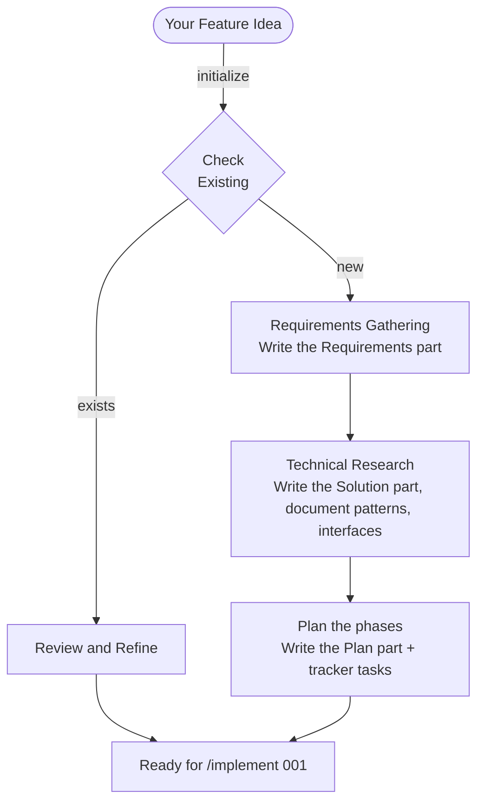
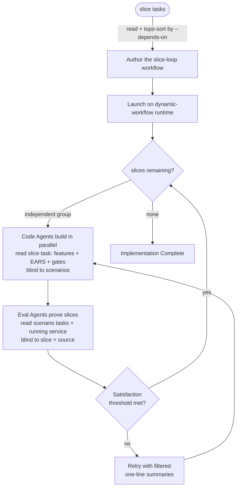
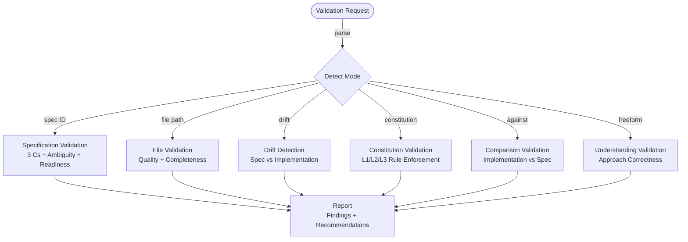
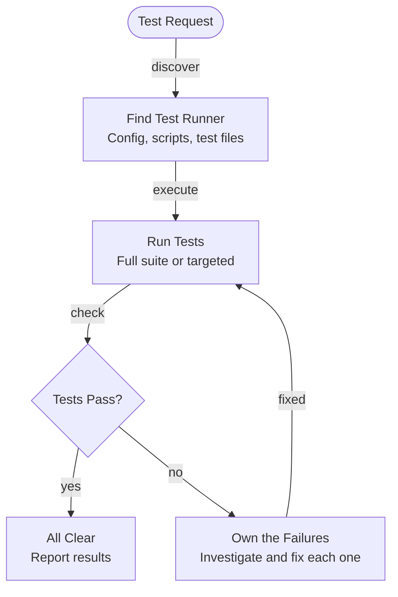
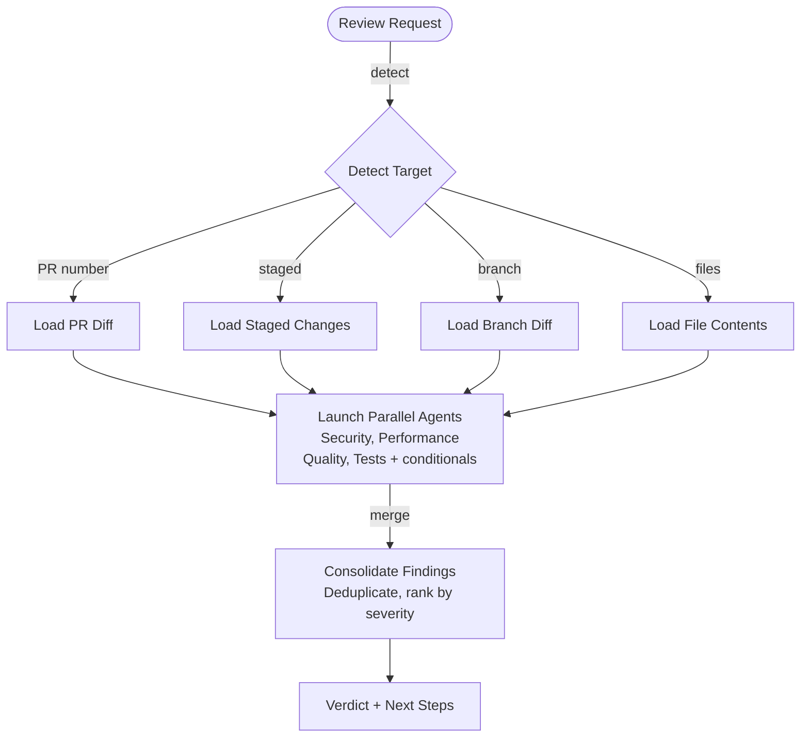
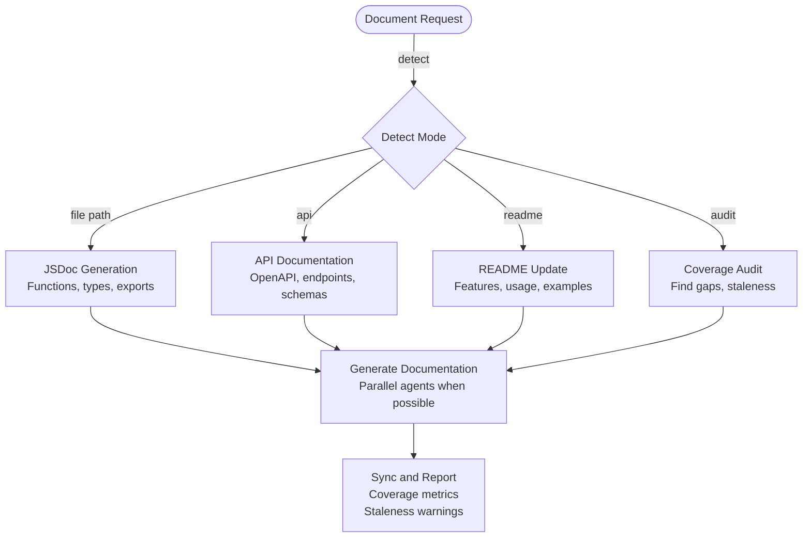
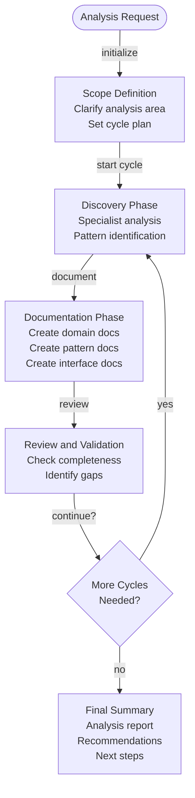
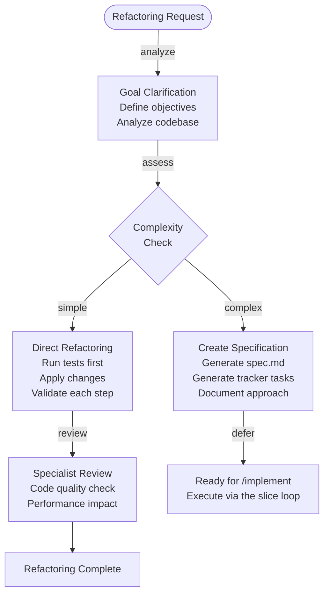
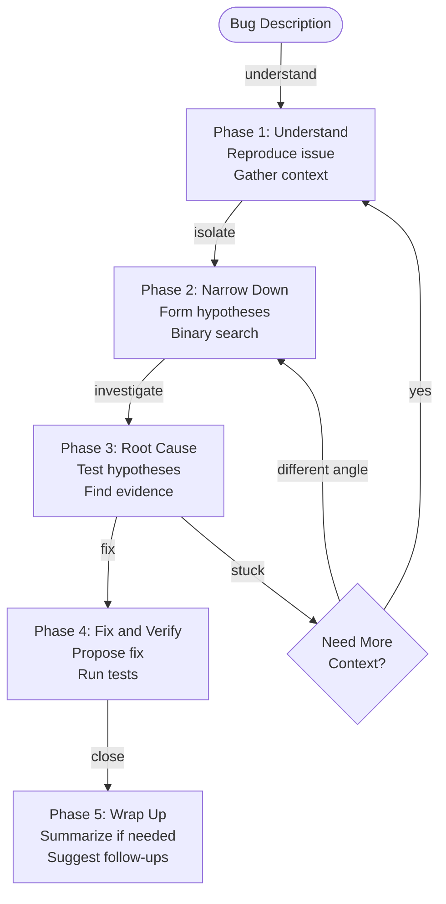
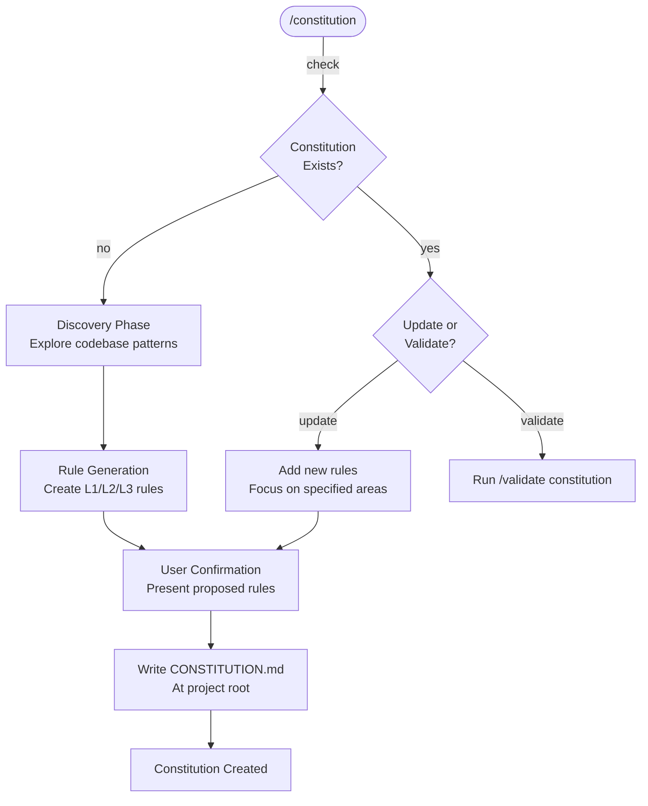

# Start プラグイン - The Agentic Startup

**Claude Code で仕様駆動開発を行うためのワークフロー編成プラグインです。**

`start` プラグインは、10 個のユーザーが呼び出せるワークフロー技能、5 つの自律技能、3 つの出力スタイルを提供し、Claude Code でのソフトウェア開発の方法を変えます。

**クイックスタート、ワークフローガイド、技能の選択については[メイン README](../../README.md) を参照してください。**

---

## 目次

- [ユーザーが呼び出す技能](#ユーザーが呼び出す技能) — specify、implement、validate、test、review、document、analyze、refactor、debug、constitution
- [自律技能](#自律技能) — コンテキストで起動する 5 つの技能
- [ドキュメント構造](#ドキュメント構造) — 仕様、ドメイン、パターン、インターフェース
- [出力スタイル](#出力スタイル) — The Garage、The Startup、The ScaleUp
- [典型的な開発ワークフロー](#典型的な開発ワークフロー) — 主軸と保守のフロー
- [実例](#実例) — 実際の使用例
- [テンプレート](#テンプレート) — PRD、SDD、Plan、Scenario
- [思想](#思想) — 仕様駆動開発の原則

---

## ユーザーが呼び出す技能

これらの技能はユーザーがスラッシュコマンド（例：`/specify`）で呼び出します。コンテキストに応じて自動的に起動する自律技能とは異なり、明示的な呼び出しを待ちます。

### `/specify <description>`

詳細な調査と専門家 agent の連携を通じて、簡潔な説明から包括的な仕様を作成します。物語形式の計画と、`/implement` が実行するスライスタスクを生成します。

**目的：** アイデアを、プロダクト要件、ソリューション設計、計画を備えた実装可能な仕様へ変換します。`spec.md` 1 つと、トラッカー内の実装タスクが成果物です。

**使い方：**
```bash
/specify Build a real-time notification system with WebSocket support
/specify 001  # 既存の仕様作業を再開する
```

**主な機能：**
- **仕様 ID の自動インクリメント** — 番号付きディレクトリ（001、002 など）を自動作成します
- **再開機能** — ID を指定して既存の仕様の作業を再開できます
- **スライス化された計画** — 作業を自己完結したスライスタスクに分割します。各タスクは機能（AC）、EARS の振る舞い、品質ゲートを対応付け、保持用シナリオを別のシナリオ子タスクとして持ちます
- **依存関係順** — スライス同士で `--depends-on` を宣言し、そのグラフが `/implement` が使う並列化の契約になります
- **パターンの文書化** — 発見したパターンを `docs/patterns/` に自動記録します
- **インターフェースの文書化** — 外部サービスの契約を `docs/interfaces/` に記録します
- **ドメインの文書化** — ビジネスルールを `docs/domain/` に記録します
- **品質ゲート** — 主要な段階の間でユーザーの承認を要求します

**各スライスのコードブリーフは 3 つの側面を対応付けます：**

| 側面 | 出典 | 役割 |
|-------|--------|------|
| **機能**（受け入れ基準） | 要件パート | スライスが何を届けるか |
| **振る舞い**（EARS） | ソリューションパート | どのように振る舞うべきか |
| **品質ゲート** | 派生 | 検査可能な条件 |

**受け入れシナリオ**は別のシナリオ子タスク（保持用の証拠）で、どのように証明されるかを示します。

<details>
<summary><strong>詳細を見る</strong></summary>

**成果物：** `.start/specs/[NNN]-[name]/spec.md` という 1 つの文書で、それぞれ独自の承認ゲートで締めくくられる 3 つのパートから成ります：

- **要件（Requirements）** — ユーザーストーリー、機能仕様、成功基準、非機能要件
- **ソリューション（Solution）** — 技術アーキテクチャ、システムコンポーネント、データモデル、技術スタック
- **計画（Plan）** — 目標状態と、成果物を伴う各段階。実装タスク（段階 → スライス → シナリオ子タスク）は **.tracker/** にあります

Ledger パートには、未解決の質問、前提、決定ログ、受け入れられたレビューのトレードオフが記録されます。



</details>

---

### `/implement <spec-id>`

仕様のスライスタスクを Claude Code の動的ワークフローランタイムで実行します。

**目的：** 検証済みの仕様を、1 つのループで動作するコードへ変換します。各スライスをコード agent が構築し、eval agent が証明します。両者の間には情報の壁があり、満足度の閾値に達するまで再試行します。

**使い方：**
```bash
/implement 001
/implement path/to/custom/spec/
```

**動作の仕組み：**

`/implement` はトラッカーから仕様のスライスタスクを読み、`--depends-on` で位相順序に並べ替えます。そして技能のループ契約から 1 つの動的ワークフローを作成して実行します：

| 手順 | 内容 |
|------|--------------|
| **読み取り** | スライスタスクを読みます（`task.js graph`）。各タスクにはコードブリーフ（機能 + EARS + ゲート）と、保持用シナリオのシナリオ子タスクが付いています |
| **起動** | 技能のループ契約からワークフロースクリプトを書き、Workflow ツールで実行します。独立したスライスは並行して実行されます |
| **ループ** | 段階ごとに：コード agent がスライスを構築します（スライス同士が連鎖する段階は 1 体、並行可能なスライスは 1 スライスずつ。シナリオは見せません）→ eval agent がプロジェクト外に置いた保持用スクリプトで段階を証明します（シナリオタスクは読み、スライスとソースは見せません）→ 閾値または最大反復回数まで、絞り込んだ要約で再試行します |

**主な機能：**
- **1 つのループ、状況に応じた規模** — 1 スライスの計画は短いループになり、40 スライスの計画は広がります。階層や戦略を選ぶ必要はありません
- **構造的な情報の壁** — 壁とは各 agent が読むタスクのことです。コード agent はスライスタスク、eval agent はシナリオ子タスクを読みます
- **再開可能** — 動的ワークフローランタイムはセッション内で完了した agent をキャッシュから再開します
- **ドリフト検出** — `Skill(start:validate)` のドリフト検査を実行します
- **憲法の強制** — L1/L2 の違反は完了をブロックします
- **リアルタイム更新** — `/workflows` にスライスごとの進捗が表示されます

<details>
<summary><strong>詳細を見る — スライスループ</strong></summary>

トラッカーから仕様のスライスタスクを読み、`--depends-on` で位相順序に並べ替えます。技能のループ契約から書いた動的ワークフローを実行します。各段階は壁で隔てられたコード→eval ループを経ます。コード agent はスライスを構築し（スライスタスクの機能 + EARS + ゲートと AGENTS.md を読み、シナリオ子タスクは決して読みません）、eval agent はプロジェクト外に置いた保持用スクリプトでそのシナリオタスクに対して段階を証明します（稼働中のサービスと、UI シナリオでは実際のブラウザーにアクセスしますが、スライスとソースにはアクセスしません）。絞り込んだ 1 行の失敗要約が次の再試行に渡され、満足度の閾値または最大反復回数に達するまで続きます。スライスが依存チェーンを形成する段階は 1 つのコード agent が構築し、並行可能なスライスはそれぞれ独自の agent が同時に構築します。



</details>

---

### `/validate <target>`

インテリジェントなコンテキスト検出と 3 Cs フレームワーク（完全性 Completeness、一貫性 Consistency、正確性 Correctness）で仕様、実装、理解を検証します。

**目的：** 仕様作成中、実装前、完了後を問わず、ライフサイクルのどの段階でも機能する品質ゲートです。

**使い方：**
```bash
/validate 001                                          # ID で仕様を検証
/validate .start/specs/001/spec.md                      # 特定のファイルを検証
/validate Check the auth implementation against SDD    # 実装と仕様を比較
/validate drift                                        # 仕様と実装のドリフトを検査
/validate constitution                                 # 憲法への準拠を検証
/validate Is my caching approach correct?              # 理解を検証
```

**主な機能：**
- **インテリジェントなモード検出** — 入力から検証の種類を自動判定します
- **3 Cs フレームワーク** — 完全性、一貫性、正確性を検査します
- **曖昧さの検出** — 「should」「various」「etc.」のような曖昧な表現を探します
- **文書間のトレーサビリティ** — 要件からソリューション、マニフェストまでの整合性を検証します
- **ドリフト検出** — 仕様と実装の整合性を検査します
- **憲法の強制** — L1/L2/L3 のガバナンスルールを検証します
- **助言のみ** — ブロックせずに推奨事項を提示します
- **比較検証** — 実装を仕様と比較します

<details>
<summary><strong>詳細を見る</strong></summary>

入力から自動的に検出される **6 つの検証モード**：

| 入力の種類 | モード | 検証内容 |
|------------|------|---------------------|
| 仕様 ID（`005`） | 仕様 | 仕様全体の品質と準備状況 |
| ファイルパス（`src/auth.ts`） | ファイル | 個別ファイルの品質 |
| `drift` または `check drift` | ドリフト検出 | 仕様と実装の整合性 |
| `constitution` | 憲法 | ガバナンスルールへの準拠 |
| 「X を Y と照合して」 | 比較 | 実装対仕様 |
| 自由記述テキスト | 理解 | アプローチの正しさ |

**3 Cs フレームワーク：**

1. **完全性** — すべてのセクションが埋まっている、`[NEEDS CLARIFICATION]` マーカーがない、チェックリストが完了している
2. **一貫性** — 文書間のトレーサビリティ、用語の整合、矛盾がない
3. **正確性** — ADR が確認済み、依存関係が有効、受け入れ基準がテスト可能



</details>

---

### `/test [target]`

厳格なコード所有権の強制付きでテストを実行します。「元から失敗していた」という言い訳は認めません。

**目的：** テストを発見・実行し、コードベースが通る状態に保ち、遭遇した失敗の責任を明確にします。

**使い方：**
```bash
/test                            # 全テストスイートを実行
/test all                        # 全テストスイートを実行（明示）
/test src/auth/                  # 特定のパスのテストを実行
/test baseline                   # 現在のテスト状態を記録
```

**主な機能：**
- **テストの発見** — テストランナー、設定、テストファイルを自動検出します
- **コード所有権** — テストが失敗したら修正は自分の責任です。既存の問題に責任転嫁しません
- **ベースライン取得** — 変更前に現在の成功／失敗状態を記録します
- **複数 agent の並列化** — テストスイートを並列 agent に分散できます
- **対象を絞った実行** — 特定のテストファイル、ディレクトリ、またはスイート全体を実行します

<details>
<summary><strong>詳細を見る</strong></summary>

**所有権の命令：**

テストが失敗したとき、技能は厳格な所有権を強制します：
- 「元から失敗していた」は不可
- 「自分の変更が原因ではない」は不可
- 失敗するテストをユーザーに残すことは不可

**テストモード：**

| 入力 | モード | 内容 |
|-------|------|--------------|
| （空）または `all` | 全スイート | すべてのテストを発見して実行 |
| ファイル／ディレクトリのパス | 対象指定 | 特定の範囲のテストを実行 |
| `baseline` | 取得 | 比較用に現在のテスト状態を記録 |



</details>

---

### `/review [target]`

専門的な観点で並行して動作する複数 agent によるコードレビューです。

**目的：** マージ前の包括的なレビュー。専門 agent が異なる関心領域を同時に検査します。

**使い方：**
```bash
/review                          # ステージング済みの変更をレビュー
/review 123                      # PR 番号をレビュー
/review feature/auth             # ブランチの変更をレビュー
/review src/auth/ src/users/     # 特定のファイル／ディレクトリをレビュー
/review staged                   # ステージング済みの変更を明示的にレビュー
```

**主な機能：**
- **並行する専門家** — セキュリティ、パフォーマンス、品質、テストの各 agent が同時にレビューします
- **条件付きの観点** — 並行処理、依存関係、互換性、アクセシビリティは関連する場合に起動します
- **対象の自動検出** — PR 番号、ステージング済み変更、ファイルパス、ブランチの差分を検出します
- **信頼度スコア** — 各指摘に信頼度（HIGH/MEDIUM/LOW）が付きます
- **重大度の分類** — CRITICAL、HIGH、MEDIUM、LOW の指摘
- **標準またはチームモード** — 送りっ放しのサブ agent、または連携する永続的なチームメンバー

<details>
<summary><strong>詳細を見る</strong></summary>

**常に有効な中核の観点：**

| 観点 | 重点領域 |
|-------------|-------------|
| **セキュリティ** | SQL インジェクション、XSS、ハードコードされたシークレット、認証バイパス、入力検証 |
| **パフォーマンス** | N+1 クエリ、インデックスの欠落、メモリリーク、非効率なアルゴリズム |
| **品質** | コードの複雑さ、命名、SOLID 原則、エラー処理、重複 |
| **テスト** | カバレッジの穴、エッジケースの欠落、テストの品質、アサーションの完全性 |

**関連する場合に起動する観点：**

| 観点 | 起動条件 |
|-------------|---------|
| **並行処理** | async/await、Promise、スレッドが検出された |
| **依存関係** | 依存関係ファイルの変更 |
| **互換性** | 公開 API またはスキーマの変更 |
| **アクセシビリティ** | フロントエンドコンポーネントの変更 |
| **憲法** | プロジェクトに CONSTITUTION.md がある |



</details>

---

### `/document [target]`

API ドキュメント、README、JSDoc コメント、ドキュメント監査を含むドキュメントを生成・同期します。

**目的：** ドキュメントをコードと同期させ、不足しているドキュメントを生成し、古くなった箇所を特定します。

**使い方：**
```bash
/document src/api/               # API ドキュメントを生成
/document readme                 # プロジェクトの README を更新
/document src/utils/             # コードに JSDoc を追加
/document audit                  # ドキュメントのカバレッジを監査
```

**主な機能：**
- **複数のドキュメントモード** — コード、API、README、監査、モジュール
- **陳腐化の検出** — 古くなったドキュメントを特定します
- **カバレッジ指標** — ドキュメントの完成度をパーセントで報告します
- **OpenAPI の生成** — API コードから OpenAPI/Swagger 仕様を作成します
- **複数 agent の並列化** — 複数のドキュメント agent が同時に作業します

<details>
<summary><strong>詳細を見る</strong></summary>

**ドキュメントモード：**

| 入力 | モード | 成果物 |
|-------|------|--------|
| ファイル／ディレクトリのパス | コード | JSDoc/TSDoc コメント |
| `api` | API | OpenAPI 仕様、エンドポイントのドキュメント |
| `readme` | README | README.md の更新 |
| `audit` | 監査 | カバレッジレポート |

**陳腐化の検出：**

この技能は次の方法でドキュメントの陳腐化を自動検出します：
- ドキュメントのタイムスタンプとコードの変更を比較
- 文書化された API がまだ実装と一致しているか確認
- 文書化されていない新しい export を特定



</details>

---

### `/analyze <area>`

反復的な探索を通じて、ビジネスルール、技術的パターン、システムインターフェースを発見・文書化します。

**目的：** 既存のコードベースから組織の知識を抽出し、再利用可能なドキュメントを作成します。

**使い方：**
```bash
/analyze security patterns in authentication
/analyze business rules for user permissions
/analyze technical patterns in our microservices architecture
```

<details>
<summary><strong>詳細を見る</strong></summary>

発見・文書化・レビューの循環的なワークフローで組織の知識を抽出します。専門 agent がコードベースを探索し、ビジネス、技術、セキュリティ、パフォーマンス、統合、データ、テスト、デプロイの各領域にわたるパターン、ルール、インターフェースを特定します。ドキュメントは `docs/domain/`、`docs/patterns/`、`docs/interfaces/` に自動的に整理されます。



</details>

---

### `/refactor <description>`

テストで検証した段階的な変更により、既存のすべての振る舞いを厳密に保ちながらコード品質を改善します。

**目的：** テスト失敗時に自動ロールバックする、安全で体系的なリファクタリング。

**使い方：**
```bash
/refactor Simplify the authentication middleware for better testability
/refactor Improve the WebSocket connection manager
```

<details>
<summary><strong>詳細を見る</strong></summary>

テストで検証した段階的な変更によって振る舞いを厳密に保持します。リファクタリング開始前と各変更後に、すべてのテストが通る必要があります。テスト失敗時は自動的にロールバックします。単純なリファクタリングでは継続的な検証付きで変更を直接適用します。複雑なリファクタリングでは仕様文書を作成し、計画された実行のために `/implement` に委ねます。



</details>

---

### `/debug <description>`

体系的な根本原因分析を行う対話型の調査で、バグを診断・解決します。

**目的：** 硬直した手順ではなく対話によって問題の特定と修正を支援する、自然言語のデバッグパートナー。

**使い方：**
```bash
/debug The API returns 500 errors when uploading large files
/debug Tests are failing intermittently on CI but pass locally
/debug Users report slow page loads after the latest deployment
```

**主な機能：**
- **対話的な流れ** — 硬いチェックリストや手順ではなく、自然な対話です
- **段階的な開示** — 要約から始め、要求があれば詳細を開きます
- **観測可能な動作だけ** — 実際に確認して見つけたことだけを報告します
- **ユーザー主導** — 次の手順を提案し、方向性はユーザーが決めます
- **仮説の追跡** — 順序付けた仮説を体系的に立てて検証します
- **証拠に基づく** — 根拠をでっち上げず、すべての結論に証拠があります

<details>
<summary><strong>詳細を見る</strong></summary>

5 つの自然な段階を踏む対話型のアプローチです：問題を理解する、範囲を絞る、根本原因を見つける、修正して検証する、締めくくる。デバッガーは観測可能な動作だけを報告し（「X を確認して Y を見つけました」）、根拠をでっち上げません。ユーザーはいつでも「何を確認したの？」と尋ねられ、正直で検証可能な回答が得られます。



**四つの戒律：**
1. **対話的であること、手順的でないこと** — チェックリストではなく対話です
2. **観測可能なことだけ** — 「これはたぶん……」ではなく「X を見て Y を見つけました」
3. **段階的な開示** — 簡潔に始め、要求があれば広げます
4. **ユーザーが主導権を持つ** — 「これをします」ではなく「こちらを試しましょうか？」

</details>

---

### `/constitution [focus-areas]`

発見に基づくパターン分析で、ガバナンスルールを持つプロジェクト憲法を作成・更新します。

**目的：** 実装、レビュー、検証の際に強制される、検査可能なプロジェクトルールを確立します。

**使い方：**
```bash
/constitution                                    # コードベースの発見から新しい憲法を作成
/constitution security and testing               # 特定の領域に焦点を当てる
/constitution Add API patterns                   # 既存の憲法を更新
```

**主な機能：**
- **発見に基づくルール** — 実際のコードベースのパターンを分析し、フレームワークを前提としません
- **L1/L2/L3 のレベル体系** — L1（ブロック + 自動修正）、L2（ブロック、手動）、L3（助言）
- **3 層の強制** — specify（SDD）、implement、review の際に検査します
- **パターン + チェックルール** — 正規表現パターンと、LLM が意味的に解釈する検査をサポートします
- **適切な劣化** — 憲法がなくてもシステムは通常どおり動作します

<details>
<summary><strong>詳細を見る</strong></summary>

プロジェクトルートに `CONSTITUTION.md` を作成します（README、LICENSE、CODE_OF_CONDUCT と同じ場所）。憲法は開発中の違反を検出する、検査可能なガードレールを定義します。

**重要な違い：**
- **CLAUDE.md** = プロジェクトの説明と AI への指示（「React と TypeScript を使う」）
- **CONSTITUTION.md** = 違反を捕捉する検査可能なルール（「barrel export は禁止」）

**レベルの定義：**

| レベル | 名前 | ブロック | 自動修正 | 用途 |
|-------|------|----------|---------|----------|
| **L1** | Must | はい | AI が自動修正 | セキュリティ、正確性、重要なアーキテクチャ |
| **L2** | Should | はい | いいえ | 人間の判断が必要な重要なルール |
| **L3** | May | いいえ | いいえ | スタイルの好み、提案 |

**ルール形式の例：**

```markdown
### No Hardcoded Secrets

\`\`\`yaml
level: L1
pattern: "(api_key|secret|password)\\s*[:=]\\s*['\"][^'\"]{8,}['\"]"
scope: "**/*.{ts,js}"
exclude: "**/*.test.*, .env.example"
message: Hardcoded secret detected. Use environment variables.
\`\`\`

Secrets must never be committed to source control.
```

**3 層の強制：**

| 段階 | コマンド | 強制内容 |
|-------|---------|-------------|
| **計画** | `/specify`（SDD） | SDD は憲法の原則に違反してはならない |
| **タスク** | `/implement` | タスクの順序が憲法の優先順位を尊重する |
| **実装** | `/implement` | 生成コードを検査し、L1/L2 の違反は完了をブロック |



</details>

---

### インストール

対話型インストーラーで The Agentic Startup フレームワークをインストールします：

```bash
npx the-startup
```

**動作：**
- Claude のマーケットプレース installing と、他のハーネス向けのファイルベースのインストールの両方に対応
- プラグインの複数選択を促します
- ファイルインストールモードでは、ハーネスとインストール先を尋ねます
- リモートの GitHub リポジトリからファイルインストール用の成果物をコピーします

**フラグ：**
- `--help` — 使い方を表示します

**注：** 出力スタイルは `/config` で選択します — [出力スタイル](#出力スタイル)を参照してください。

---

## 自律技能

`start` プラグインには、コンテキストに応じて自動的に起動する 5 つの自律技能が含まれます。明示的に呼び出す必要はなく、必要なときに動作します。

### 仕様作成技能

| 技能 | 目的 |
|-------|---------|
| `specify-meta` | 仕様ディレクトリの作成、README の追跡、段階の遷移 |
| `specify-requirements` | プロダクト要件のテンプレート、検証、要件収集 |
| `specify-solution` | ソリューション設計のテンプレート、アーキテクチャ設計、ADR 管理 |
| `specify-plan` | 物語形式の計画と、トラッカー内のスライス・シナリオタスクを作成 |

### 実装技能

| 技能 | 目的 |
|-------|---------|
| `implement` | スライスループを動的ワークフローとして実行 — スライスごとに壁で隔てたコード→eval の再試行 |

---

## ドキュメント構造

このプラグインは構造化された知識管理を推奨します：

```
.start/
└── specs/
    └── [3-digit-number]-[feature-name]/
        ├── spec.md                          # 要件、ソリューション、計画のパート + Ledger
        ├── review.md                        # ソリューションのレビューレポート
        ├── events.jsonl                     # ダッシュボードが再生するイベントログ
        └── .tracker/                        # 実装タスク（段階 → スライス → シナリオ）

docs/
├── domain/                                  # ビジネスルール
│   ├── user-permissions.md
│   ├── order-workflow.md
│   └── pricing-rules.md
│
├── patterns/                                # 技術的パターン
│   ├── authentication-flow.md
│   ├── caching-strategy.md
│   └── error-handling.md
│
└── interfaces/                              # 外部連携
    ├── stripe-payments.md
    ├── sendgrid-webhooks.md
    └── oauth-providers.md
```

### 自動ドキュメント化

`document` 技能の Capture 観点は、次の場面でパターン、インターフェース、ドメインルールが発見されると、正しい場所にファイルを自動作成します：
- 仕様作成（`/specify`）
- 実装（`/implement`）
- 分析（`/analyze`）

### 重複排除

capture ワークフローは新しいファイルを作成する前に常に既存のドキュメントを確認し、重複を防ぎます。

---

## 出力スタイル

`start` プラグインには 3 つの出力スタイルが同梱されています。企業の段階ごとに 1 つずつです。スタイルは Claude の伝え方と適用するプロセスの量を変えますが、知識そのものは変えません。3 つすべてが Claude Code の組み込みエンジニアリング指示を保持し（`keep-coding-instructions: true`）、スタイルはメインの会話だけに影響し、サブ agent とプラグインのワークフローには影響しません。

仕事の相手に合った調子を選んでください：

| スタイル | 調子 | こんなときに |
|-------|----------|-------------------|
| **The Garage** | 創業前 — 動く最小のものを作り、最小限しか語らない | プロトタイプやスパイク。まだ重要なものはなく、そのものが動くかを見極めている段階 |
| **The Startup** | ソロ — 1 人のエンジニア、1 つの agent、儀式なし | あなただけのとき。委任も、承認のための計画ごっこも、第三者向けのステータスも不要 |
| **The ScaleUp** | 協調 — 他の人を通じて進む仕事 | 会話にいなかった誰かが書いたものを読み、変更したものに触れる。委任して足跡を残す |

### スタイルの有効化

`/output-style` コマンドは Claude Code v2.1.91 で削除されました。現在の選択方法：

- **対話的：** `/config` → Output style。
- **直接：** `/config outputStyle=The Startup`（Claude Code v2.1.181+）。
- **プロジェクト固定**（git でチームと共有）は `.claude/settings.json` に：

  ```json
  { "outputStyle": "The Garage" }
  ```

  個人用のプロジェクト単位の選択には `.claude/settings.local.json`、すべてのプロジェクトには `~/.claude/settings.json` を使います。優先順位は local > project > user です。変更は次のセッション（または `/clear` 後）に反映されます。

このプラグインは意図的にスタイルを強制 **しません**（3 つすべてで `force-for-plugin` は未設定）。段階を決めるのはあなたであり、強制されたスタイルはプラグインが有効な間、`/config` での選択と設定ファイルの固定の両方を上書きしてしまいます。

---

## 典型的な開発ワークフロー

### セットアップ（任意）

```
/constitution ──> プロジェクトのガバナンスルールを作成
                  L1/L2/L3 ルールを BUILD フローで自動強制
                  プロジェクトルートに CONSTITUTION.md
```

### 主軸のワークフロー：指定 > 検証 > 実装 > レビュー

```
/specify ──> /validate ──> /implement ──> /review
   |              |              |              |
仕様を作成      品質を検査    スライスループ   コードレビュー
PRD+SDD+Plan     3 Cs          code↔eval        セキュリティ+性能
   |              |              |              |
憲法を         憲法モード     憲法による       憲法準拠
SDD で検査     も利用可能     ドリフト強制     を検査

任意：実装後に /document でドキュメントを同期
```

*`CONSTITUTION.md` がある場合は、各段階でルールが自動的に検査されます。*

**1. 仕様を作成**

```bash
/specify Add real-time notification system with WebSocket support
```

**内容：**
- `.start/specs/001-notification-system/` を作成
- spec.md とトラッカータスクを生成
- 発見したパターン／インターフェースを文書化
- 任意：`spec/001-notification-system` という git ブランチを作成

**2. 実装前に検証（推奨）**

```bash
/validate 001
```

**内容：**
- 完全性、一貫性、正確性（3 Cs）を検査
- 曖昧さや漠然とした表現を検出
- 一般的な脆弱性についてセキュリティスキャン
- 文書間のトレーサビリティを検証

**3. 実装を実行**

```bash
/implement 001
```

**内容：**
- 任意：`feature/001-notification-system` という git ブランチを作成
- スライスループを動的ワークフローとして実行
- スライスごとに：コード agent が構築し、eval agent が保持用シナリオタスクに対して証明
- 満足度の閾値に達するまで、絞り込んだ失敗要約で再試行
- 任意：完了時に PR を作成

**4. マージ前にレビュー**

```bash
/review
```

**内容：**
- 並行する専門家がレビュー（セキュリティ、パフォーマンス、品質、テスト ＋ 条件付き観点）
- 重大度順に整理したレポートを生成

**5. ドキュメントを生成（任意）**

```bash
/document src/notifications/
```

**内容：**
- JSDoc/TSDoc コメントを追加
- 必要なら README を更新
- ドキュメントのカバレッジを報告

---

### 保守のワークフロー

**既存のコードを理解する**

```bash
/analyze security patterns in authentication
```

結果を `docs/patterns/`、`docs/domain/`、`docs/interfaces/` に文書化します。

**リファクタリング**

```bash
/refactor Restructure the authentication module for better testability
```

アーキテクチャの変更では、仕様を作成し、移行を計画し、破壊的な変更を処理します。

**バグを直す**

```bash
/debug The notification system stops working after 100 concurrent users
```

観測可能な証拠とユーザー主導の方向性による対話型の調査を行います。

**ドキュメントを監査**

```bash
/document audit
```

ドキュメントのカバレッジを報告し、古いまたは不足しているドキュメントを特定します。

---

## 実例

### 例：document 技能による知識の取り込み

**シナリオ：** 実装中に agent がパターンを発見した

```
Agent output: "I implemented a retry mechanism with exponential backoff for API calls"
```

**自動的に起こること：**
1. document 技能の Capture 観点が起動
2. `docs/patterns/` で既存のリトライパターンを確認
3. 見つからないため、`docs/patterns/api-retry-strategy.md` を作成
4. パターンのテンプレートを使用
5. 報告：「Created docs/patterns/api-retry-strategy.md」

**あなたがしなくてよいこと：** ドキュメント化を明示的に頼む、パスを指定する

---

## テンプレート

構造化されたドキュメント用の充実したテンプレートが、それぞれの技能と同じ場所にあります：

```
plugins/start/skills/
├── specify-meta/template.md             # spec.md の構造：要件、ソリューション、計画、Ledger
├── specify-plan/templates/scenario.md   # 保持用シナリオタスクの本文テンプレート
└── document/templates/                  # 知識取り込み用テンプレート
    ├── domain-template.md               # ビジネスルール
    ├── pattern-template.md              # 技術的パターン
    └── interface-template.md            # 外部連携
```

**使い方：** `/specify` と `/document` がドキュメント作成時に自動で使用します。

---

## 思想

### 仕様駆動開発

**問題：** 明確な要件なしに作られた機能は、技術的負債、やり直し、不整合を招きます。

**私たちのアプローチ：**

1. **まず仕様を決める** — コードの前に包括的な仕様を用意します
2. **レビューと洗練** — ステークホルダーと検証します
3. **自信を持って実装** — 検証済みの計画を実行します
4. **文書化と学習** — 再利用のためにパターンを取り込みます

**中核の原則：**

- **二度測って一度切る** — 事前の計画は時間を節約します
- **ドキュメントはコード** — 仕様はコードベースと一緒に進化します
- **並列実行** — 複数の専門家、明確な境界
- **品質ゲート** — DOR/DOD が基準を強制します
- **段階的な開示** — 詳細は必要なときに読み込みます

---

## 参考資料

- **[メイン README](../../README.md)** — プロジェクトの概要とインストール

## 出典とライセンス

- 原作者：[rsmdt](https://github.com/rsmdt/the-startup)
- 元リポジトリ：https://github.com/rsmdt/the-startup
- ライセンス：MIT
- 日本語翻訳と UI ローカライズ：claude-code-mods-ja プロジェクト
